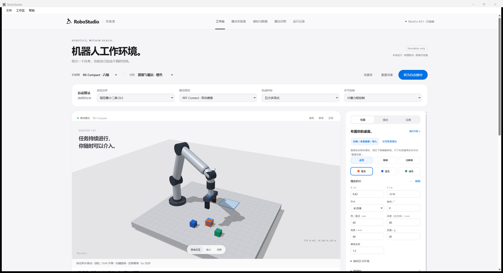

# RoboStudio

**机械臂算法与物理仿真工作环境 · v0.8.0**

[下载 Windows App](https://github.com/THEr1stan/RoboStudio/releases/latest) ·
[第一次使用](docs/QUICK_START.md) · [自定义场景](docs/SCENES.md) ·
[算法与操作](docs/USER_GUIDE.md) · [开发构建](docs/DEVELOPMENT.md) · [MIT 许可证](LICENSE)

An interactive robotics simulation workspace with MuJoCo contact physics, motion planning,
inverse kinematics, live intervention, and reproducible experiment records.

给机械臂一个持续任务，在三维现场拖动物体、移动末端、施加外力，观察它如何用逆运动学、
路径规划和力矩控制完成抓取。物理任务由 MuJoCo 执行，实验记录保留配置、操作、算法过程与测量数据。



## 直接使用

Windows 便携版：解压完整的 `RoboStudio-0.8.0-win-x64` 文件夹，双击 **RoboStudio.exe**。
从上方下载链接的 **Assets** 选择 Windows ZIP；GitHub 的 **Source code** 是开发者源码。
项目本机已有构建时，也可双击根目录 **Start-RoboStudio.cmd**。
独立窗口、独立场景存储、内置 Python 运行环境，不需要打开浏览器或终端。
需要 Windows 10/11 x64、.NET Framework 4.8 和 WebView2 Evergreen Runtime。

打开“场景库 → 工业工位”，选择上下料、分拣、码垛或隔板转运，点击“载入并运行”。
顶部切换机器人与算法；直接按住积木拖动，滚轮升降，松手恢复物理。

- **机器人**：六轴 R6 Compact、三轴 XYZ Gantry，原创理想化模型。
- **算法**：DLS / 自适应 DLS / SVD / 雅可比转置；RRT / RRT-Connect / PRM；
  三种轨迹时标；计算力矩与 PD。算法选择连接实际抓取流程。
- **现场**：持续目标、接触抓取、颜色分拣、三层堆叠、外力干预、末端逆解与障碍编辑。
- **测量**：FK / Jacobian / 迭代残差、跟踪误差、接触力、射线 RGB / 深度图。
- **实验**：同条件算法对照、原始 JSON / CSV、固定种子与严格复算。
- **场景**：本机命名保存、可编辑工业预设、带验证预览的 JSON 导入导出。

完整操作与边界：[使用指南](docs/USER_GUIDE.md)。数据位置：[桌面说明](desktop/windows/README-桌面版.txt)。

## 从一次抓取到一个实验

1. **布置任务**：载入工业工位，让机械臂持续搬运、分拣或码垛。
2. **改变现场**：拖走已放好的物体、移动末端或施加外力，观察任务如何响应。
3. **查看依据**：检查逆解残差、搜索路径、跟踪误差和真实接触力。
4. **比较方法**：在相同场景、种子和预算下运行算法对照，保留成功和失败。
5. **带走结果**：保存场景 JSON、实验记录及 CSV，而不只录制一段动画。

入门：[十分钟操作路线](docs/QUICK_START.md) · 问题排查：[常见问题](docs/TROUBLESHOOTING.md)。

## 项目结构

```text
desktop/windows/           Windows 桌面窗口、图标、固定版本 SDK 信息
src/robostudio/
  core/                    类型、单位、状态/参考/命令合同
  backends/                MuJoCo / 测试后端
  registry/                能力与插件清单验证
  simulation/              场景、感知、规划、持续任务、运行记录和 API
  ui/studio/               当前工作站与 WebGL 交互
  ui/legacy/               保留的论文规格、基础验证界面
  data/                    机器人模型与算法清单
  cell_ik.py, motion.py…    共享数值算法；原实现保持不变
  studio_*.py              旧导入路径的兼容入口；实际实现见 simulation/
tests/                     合同、数值、集成、迁移、浏览器与桌面验证
scripts/build/             桌面构建、运行环境打包、源码导出
scripts/validation/        固定场景的实际物理验收
examples/                  机器人清单与可导入场景
docs/                      当前指南、架构、验证与 v0.8.0 交付
tasks/                     当前工作范围
```

`artifacts/` 是本地实验与视频，`dist/` 是构建产物，`.venv*` 是开发环境。
这些目录不会进入 GitHub 源码包；无需删除本机数据来保持仓库干净。
仓库首次提交是 v0.8.0 的完整快照，不包含旧版发布包或早期交付文档。
兼容模块与冻结测试数据属于当前版本的回归保障，继续保留。

## 开发与构建

项目由 **Python + JavaScript / HTML / CSS + C#** 组成。
Python 负责算法和 MuJoCo，JavaScript / WebGL 负责界面，C# / WebView2 负责桌面生命周期。
桌面版与网页开发入口共用同一份实现。

```powershell
python -m venv .venv
.venv/Scripts/python.exe -m pip install -r requirements-dev.lock
.venv/Scripts/python.exe -m pip install --no-build-isolation -e ".[physics]"
.venv/Scripts/python.exe -m pytest -q
.venv/Scripts/python.exe -m robostudio workbench --open
```

构建、测试、迁移与 GitHub 源码包命令见 [开发说明](docs/DEVELOPMENT.md)。
验收结果见 [v0.8.0 交付](docs/releases/DESKTOP_V080.md)。

## 当前边界

仅仿真，无真机控制。支持有界桌面场景和两种机构，尚无任意 URDF 导入、传送带、柔体、ROS 连接。
工业预设是静态工位；视觉是已知颜色的射线传感器，不是通用物体识别。
Paper-to-Simulation 当前提供规格审核与受限模板导出，不自动执行生成代码。
桌面窗口内仍采用成熟的 WebView 渲染技术，物理按界面请求推进，非硬实时系统。

## 许可与参与

原项目采用 **[MIT 许可证](LICENSE)**，版权署名为 THEr1stan。
允许使用、修改、分发和商用，要求保留版权及许可声明；按原样提供，不承诺担保。
第三方组件保留各自许可，见 [THIRD_PARTY_NOTICES.md](THIRD_PARTY_NOTICES.md)。
参与方式见 [贡献指南](CONTRIBUTING.md)，问题和建议可提交到
[Issues](https://github.com/THEr1stan/RoboStudio/issues)。
