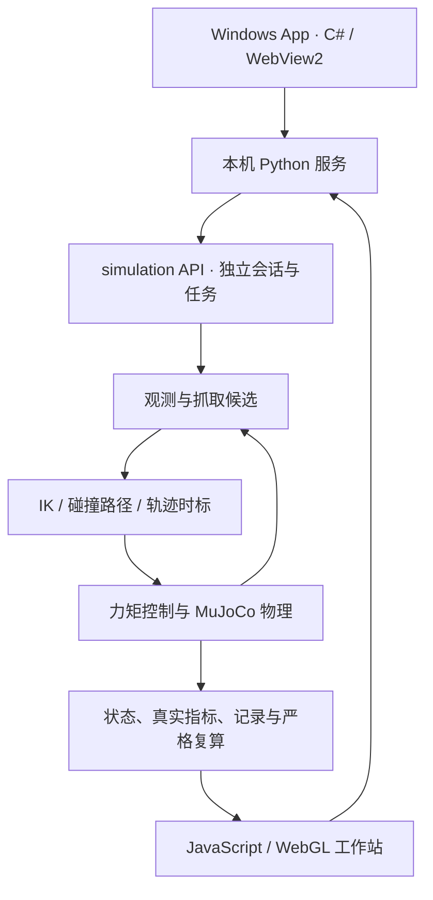

# RoboStudio v0.8 架构

## 从窗口到物理结果

桌面窗口拥有独立后端进程与 WebView 资料目录；开发用浏览器可以访问同一套服务协议。
界面显示真实状态快照，物理通过有界请求批次推进，2 ms 积分步长不意味着硬实时调度。
机器人状态、目标参考、执行命令是三个不同的合同对象。

## 模块职责

| 目录 / 模块 | 职责 |
|---|---|
| core | 带单位、坐标、状态与错误码的类型合同；不导入 UI、MuJoCo 或 AI SDK |
| registry | 机器人 / 算法清单校验，按能力匹配，提前拒绝不支持的组合 |
| backends | 引擎状态与命令适配；qpos、qvel、执行器映射显式保存 |
| data | 项目原创理想化模型、清单、参数 |
| simulation/scene.py | 场景验证、模型构建、碰撞与接触查询 |
| simulation/sensor.py | 射线 RGBD、颜色连通域、反投影、噪声与观测延迟 |
| simulation/planning.py、trajectory.py | 碰撞路径、采样规划与运动时标 |
| simulation/runtime.py、world.py、recovery.py | 持续抓取任务、物理推进、手动接管与恢复 |
| simulation/objects.py | 物体拖动与扫掠几何检查，报告阻挡部件和实际间隙 |
| simulation/lab.py | 算法过程与匹配场景的对照运行 |
| simulation/documents.py、presets.py | 可验证场景文件与四个工业预设 |
| simulation/api.py | 会话、记录与复算；不执行任意外来代码 |
| ui/studio | WebGL 渲染、输入合并、场景库、图表与交互 |
| desktop/windows、desktop_host.py | 原生窗口、后端所有权、下载与本机资料生命周期 |

`studio_*.py` 是旧导入路径的薄兼容别名，与 simulation 中的实现共享模块对象。
共享数值算法仍在 cell_ik.py、motion.py、kinematics.py 等文件；迁移不改写计算语句。
论文规格与基础验证界面保留在 ui/legacy，属于当前产品中的工具入口。

## 自主任务与人工操作

自主任务执行观测、候选选择、逆解、碰撞规划、轨迹控制、双指接触检查、搬运、释放和结果复查。
抓取不使用附着约束或预置动画。规划使用已知几何，相机估计提供目标位置；这不是未知场景重建。

连杆施力是有界外力叠加，松手清除外力并保留任务阶段；真实滑落或失败才触发恢复。
末端拖动执行逆解与检查后的目标运动。按住积木是明确的人工位置约束，松手恢复动力学，
不把这段人工移动当作自主抓取成功。参数编辑重建场景，直接交互保留连续环境。

输入使用最新目标合并，干预与物理步交替调度。界面按帧合并绘制；未变化的算法详情不重复发送。
显示缓存不参与记录与严格复算，后者仍使用完整状态、输入和物理参数。

## 数据和复现

实验保存 config、task、model、source 哈希、种子、版本、执行输入和实际指标。
物理 / 控制周期为 2 ms，画面采样通常 40 ms，相机更新 100 ms。保存帧不是全部 500 Hz 数据。
连续环境保存最近约 40 秒画面及全部输入；严格复算从初始状态重新执行并比较记录。

场景 JSON 只描述初始配置；命名场景保存在 WebView 本地存储；实验记录属于单独的目录。
源码或模型不匹配时，不应把相似画面称为严格一致。

## 桌面与信任边界

Windows 壳启动自己的 Python 子进程，通过标准输出接收就绪消息；标准输入 EOF 表示父进程结束。
Job Object 负责强制关闭时清理子进程。默认绑定 127.0.0.1:18765；冲突时失败，不接管未知服务。
WebView 限制同源导航，无任意本机命令桥；文件下载使用原生下载流程，保存到 Data/Exports。
正常启动不打开调试端口；测试使用独立资料目录。

Paper-to-Simulation 当前只有人工审核的规格和受限候选模板。
论文、URL 和生成内容均是数据，不是可信指令。来源页码和假设必须标注；
候选只写入可丢弃工作区，禁止修改核心或可信基线。没有隔离执行环境时停在审核文件。
L0 实现验证、L1 迁移验证和 L2 论文原实验复现不可混用。

详细合同见 [CONTRACTS](CONTRACTS.md)，构建与入口见 [开发说明](DEVELOPMENT.md)，
桌面迁移决策见 [ADR 0004](adr/0004-desktop-and-layout.md)。
